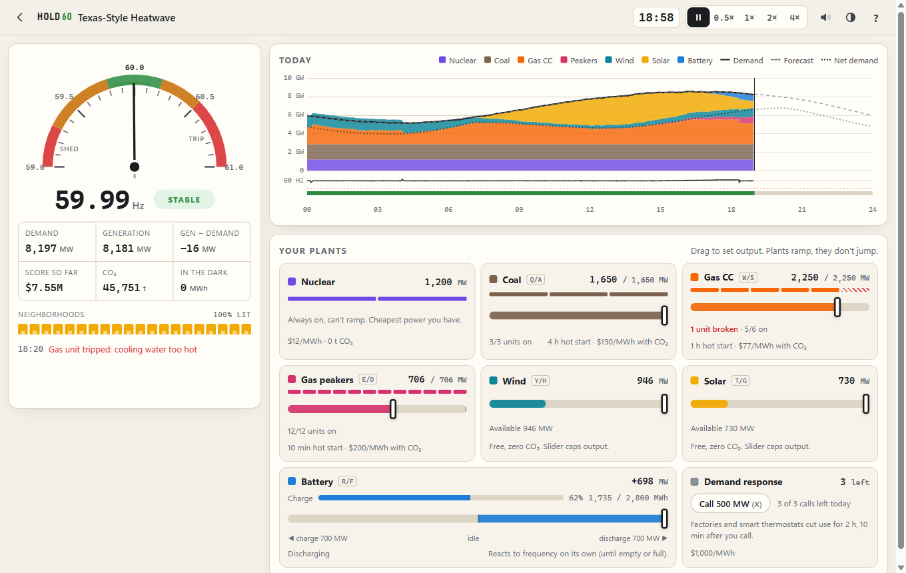
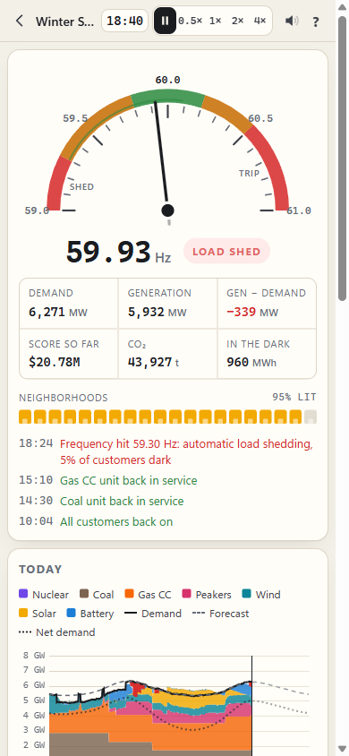
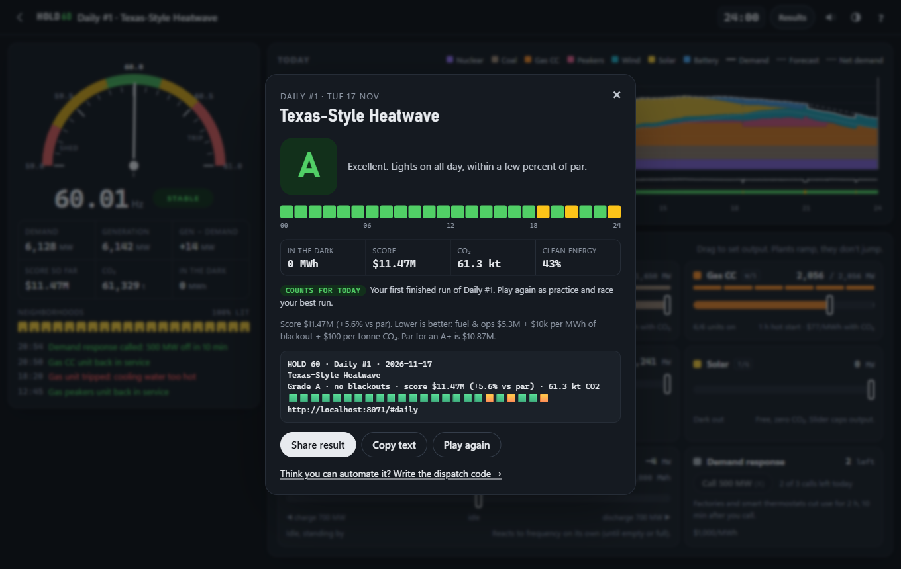
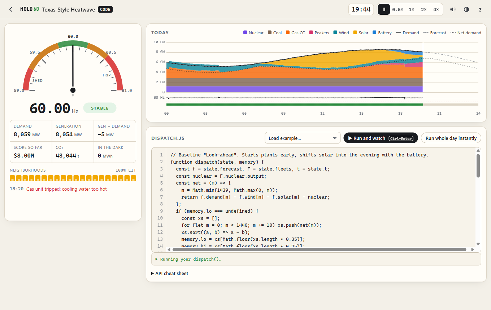

# Hold 60

**You run a US power grid for one day. Keep it at 60 Hz, or neighborhoods go dark.** Play it by hand, or write the dispatch code and race three built-in algorithms.



<!-- Swap in a GIF for launch: record ~8 s of the heatwave from 17:00 to 21:00 at 4x. -->

| Phone | Results card | Code mode |
|---|---|---|
|  |  |  |

## Play it

**Online:** _(add the GitHub Pages link here once it is deployed)_

**Locally** (any static server works; opening `index.html` straight from disk won't, because browsers block ES modules and Web Workers on `file://`):

```sh
cd grid-game
python -m http.server 8060      # or: npx http-server -p 8060
# open http://localhost:8060
```

No build step, no dependencies, and the game makes no network calls. Once the page is open it keeps working offline (there is no service worker yet, so reloading with no network won't).

**Run the tests** (Node 20+):

```sh
cd grid-game
node --test
```

### Deploy to GitHub Pages (about five minutes)

1. Create a new public repo, for example `hold-60`, and copy the contents of this `grid-game/` folder into its root (so `index.html` sits at the top).
2. Commit and push to `main`.
3. On GitHub, go to **Settings → Pages**, set **Source** to "Deploy from a branch", pick `main` and `/ (root)`, and save.
4. After a minute the game is live at `https://<your-user>.github.io/hold-60/`. All paths are relative, so it works from a sub-path.
5. **Make the preview image absolute.** In `index.html`, change `og:image` and `twitter:image` from `og-card.png` to the full URL, for example `https://<your-user>.github.io/hold-60/og-card.png`. Most crawlers (X, Slack, Discord, Facebook) ignore relative image paths, so link previews stay blank until you do. `og-card.png` (1200×630) is rendered from the game itself: serve the folder, open `/tools/og-card.html` at a 1200×630 viewport and screenshot the `#card` element.

6. **Replace the footer links.** The landing page and the results card end with "Source · How it works · MIT". The first two point at the placeholder `https://github.com/<you>/hold-60`. Search `index.html` for `<you>` (four links, plus a comment) and replace it with your GitHub user name. Until you do, both links are dead. "How it works" goes to the `## How the simulation works` heading of this README on GitHub, so keep that heading's name (or update the `#how-the-simulation-works` anchor with it). "MIT" links to the `LICENSE` file served next to the page.
7. **Optional: remove the test hook.** `window.__hold60` (at the bottom of `src/app.js`) lets browser checks and the README GIF recording fast-forward a day. It does nothing for players and is left in so you can record the GIF. To remove it before launch, delete everything from the comment line that ends in `test hook (used by the browser checks)` to the end of the file (the `window.__hold60 = { ... };` block). Nothing else refers to it and the tests never touch it. All it can do is fast-forward a game already running in the visitor's own tab.

## What you do

- **Five days**, each seeded so everyone gets the same weather and grades are comparable:
  1. **Mild Spring Day**: the tutorial. A coal unit trips at midnight and you fix it.
  2. **Texas-Style Heatwave**: air conditioning peaks at 5 pm, then the sun sets on 3.5 GW of solar (the "duck curve" evening ramp). A gas unit trips at 18:20.
  3. **Winter Storm**: heating load all night, wind turbines ice up, gas units and a nuclear unit trip one after another. Every baseline policy causes blackouts here.
  4. **The Wind Stopped**: a still September day. Everything burns, and the evening is tight.
  5. **2030: The AI Boom**: a 1.8 GW AI training campus that drops 1.3 GW in an instant when it checkpoints.
- **Today's grid** (`#daily`, the big button on the landing page): one grid per UTC calendar date, the same for everyone. The date picks a scenario from a fixed rotation (heatwave, windless, AI boom, spring, storm), a seed for the weather, peak demand within ±3%, and one surprise outage at a time that is not in the forecast (the storm instead keeps its seed and moves its scripted outages by up to 5 minutes). Daily #1 is 17 November 2026. **The counted run is your best finished run of that date**, per mode, saved in your browser: a better run replaces it, a worse one is marked **replay**, and a code run of the untouched starter template never counts (it is labelled "template run"). Replays race a faint ghost line, your best earlier run's frequency, drawn under the chart. `#code/daily` is the same date in code mode. **First visit:** until you have finished the tutorial, the big landing button starts the 30-second tutorial and then drops you straight into today's grid (a small "Skip to today's grid" link is below it). The first blackout or generator trip of a hand-played run pauses the clock once with a one-line reason and a Resume button; there is a 0.5× speed. On phones a sticky header keeps a mini frequency dial and day chart on screen while you scroll the sliders, pull-to-refresh is disabled in the game, and an in-progress daily is saved every game hour, so a reload offers "Resume your run". Par for a daily is derived from our reference policies, computed in a Web Worker as soon as the day opens (it falls back to the main thread if workers are unavailable); days with no known blackout-free run get no par. Nothing is sent anywhere, so there is no leaderboard: the share text is the leaderboard.
- **Manual mode**: drag plant setpoints, charge or discharge the battery, curtail wind and solar, call demand response. Pause and 1×/2×/4× speed (a day takes 2.4 minutes at 1×).
- **Code mode** (`#code`): write `function dispatch(state, memory)`, run the day (watch it, or instantly), and compare with three baseline policies on the same day.
- **Score**: one number, in dollars, lower is better: fuel and start-ups + $10,000 per MWh of blackout + $100 per tonne of CO₂ (more on that below). Any blackout caps the letter grade; otherwise the grade compares your number with par. You get a copy-paste result with the number, how it compares with par, and a 24-hour emoji timeline that doesn't give away your strategy:

```
Hold 60: Texas-Style Heatwave (my code)
Grade A · no blackouts · score $10.62M (+2.1% vs par · +3.1% vs code par) · 60.4 kt CO2
🟩🟩🟩🟩🟩🟩🟩🟩🟩🟩🟩🟩🟩🟩🟩🟩🟩🟩🟨🟨🟨🟩🟩🟩
https://atabeyrajabli.github.io/hold-60/#code/heatwave
```

🟩 stable · 🟨 strained (frequency more than 0.2 Hz off for 3+ minutes, or a generator trip) · 🟥 load was shed.

The daily challenge leads with a title line instead:

```
HOLD 60 · Daily #12 · 2026-11-28
Texas-Style Heatwave · best today
Grade A · no blackouts · score $10.62M (+2.1% vs par) · 60.4 kt CO2
🟩🟩🟩🟩🟩🟩🟩🟩🟩🟩🟩🟩🟩🟩🟩🟩🟩🟩🟨🟨🟨🟩🟩🟩
https://atabeyrajabli.github.io/hold-60/#daily/2026-11-28?g=A&s=10.6
```

The link carries the date, so a post opens the same grid on any day, plus the sharer's grade and score ($M). Opening it shows a dismissible banner, "A friend got A ($10.6M) on Daily #12 — can you beat it?", and the results card says whether you did. Line 2 ends with "best today" (or "best run" for an older date), "replay" or "template run".

On phones and other browsers with a share sheet, the results card's button uses `navigator.share`; elsewhere it copies to the clipboard.

Links: `#daily` opens today's grid and `#daily/YYYY-MM-DD` that date's (future dates clamp to today, malformed ones fall back to today; `#code/daily/YYYY-MM-DD` is the code-mode version; `?g=B&s=11.3` adds the friend banner); `#tutorial?then=daily` plays the tutorial and then today's grid; `#spring`, `#heatwave`, `#storm`, `#windless`, `#ai2030` open a day directly; `#code/<day>` opens it in code mode; `#tutorial` replays the tutorial.

Keyboard: `Space` pause, `1` `2` `3` speed, `Q/A` coal, `W/S` gas, `E/D` peakers, `R/F` battery, `T/G` solar cap, `Y/H` wind cap, `X` demand response, `M` grid hum, `?` help.

## How the simulation works

`src/sim.js` is a pure module (no DOM, no clock, no `Math.random`) that steps one simulated minute at a time. The browser and the tests use the same code.

**The grid.** A fictional island grid with about 6–8 GW of peak demand, like ERCOT in miniature: one system whose frequency you alone control. (Balancing authorities inside a big interconnection don't control frequency; islands such as Texas, Hawaii or Puerto Rico come closest to this.)

| Resource | Size | Ramp | Start-up (hot start) | $/MWh fuel | t CO₂/MWh |
|---|---|---|---|---|---|
| Nuclear | 2 × 600 MW | none (flat) | always on | 12 | 0 |
| Coal | 3 × 550 MW, min 45% | 5 MW/min per unit | 4 h | 30 | 1.0 |
| Gas combined cycle | 6 × 450 MW, min 40% | 12 MW/min per unit | 1 h | 40 | 0.37 |
| Gas peakers | 12 × 100 MW, min 25% | 25 MW/min per unit | 10 min | 140 | 0.6 |
| Wind | 3,000 MW | weather | — | 0 | 0 |
| Solar | 3,500 MW | weather | — | 0 | 0 |
| Battery | 700 MW / 2,800 MWh, 88% round trip | instant | — | 10 (wear) | 0 |
| Demand response | 3 calls × 500 MW × 2 h | 10 min notice | — | 1,000 | 0 |

The 2030 scenario retires a coal unit and adds gas, solar, wind and a 1.5 GW / 6 GWh battery. Start-ups also cost money ($40k coal, $12k gas, $1.5k peaker).

**Frequency.** Each minute is split into 10 substeps. In each one:

```
imbalance = generation − load
df/dt     = (imbalance − loadDamping × Δf) / M
```

- `M` acts like system inertia and grows with how much spinning thermal generation is online. Midday, when solar carries the grid, the needle moves faster. Real grids work this way too.
- Load damping: demand falls about 4% per Hz of under-frequency (real systems are closer to 2–3%, so the game is slightly generous).
- There is no governor droop, so frequency keeps drifting until you act. You are the governor. Real systems settle at a new, lower frequency within seconds.
- The battery has automatic fast frequency response: it adds `−Δf × (700 MW / 0.5 Hz)` on top of your setpoint until it runs empty or full.
- **Below 59.3 Hz**, load is shed: 5% of demand per stage. 59.3 Hz is ERCOT's first automatic under-frequency stage, but real schemes have several descending thresholds and differ between interconnections, and the February 2021 rolling blackouts were ordered by operators, not triggered automatically (frequency stayed just above 59.3 Hz). Here, blocks come back one at a time after 20 minutes of healthy frequency, and if you are still short they get cut again, which produces rolling blackouts.
- **Above 60.5 Hz**, the largest running thermal unit trips offline for 90 minutes. This is a game rule, not realism: real plants ride through much higher frequencies and governors back off first. It exists to punish over-generation.

**Plants.** You set a target and the sim works out the rest. If the target needs more units than are running, units start and only produce after their start-up delay. Output ramps toward the target at the ramp rate, and a running unit won't go below its minimum stable output. Wind and solar produce whatever the weather allows, capped by your curtailment slider.

**Score.** `score = fuel + start-ups + battery wear + DR + $10,000 × MWh unserved + $100 × t CO₂`. It is a weighted sum, not a priority list, and CO₂ is typically over half of it. Both prices are illustrative: $10,000/MWh is a round value of lost load (ERCOT's offer cap has been $5,000 since 2022 and $9,000 in 2021), and $100/t is a stand-in carbon price. The practical effect is that gas ($40 + 0.37 t ≈ $77/MWh) beats coal ($30 + 1.0 t ≈ $130/MWh) in the score, even though coal's fuel is cheaper. Any blackout caps the grade at C (under 100 MWh), D (under 1,000) or F. With no blackouts, the grade compares your score with the scenario's *par* (A+ at or under par, A within 6%, B within 18%, otherwise C). Par is the best score among our own reference policies (three baselines, a hidden hand-tuned expert and a hidden simple tuned policy). It is a target, not a proven optimum: the game shows your score and your percentage versus par, and it can go negative.

**Code par.** Par is deliberately gentle, and a plain gas-first policy beats it on days 1, 2 and 5. So code mode has a second target, *code par*: the best zero-blackout score of any reference policy we know, including a hidden gas-first one (`gasFirst` in `src/reference.js`). The code-mode comparison table shows your gap to both. Manual grades still use par, and so does the grade in code mode. Code par is reachable by construction (a test runs the policies), it can still be beaten, and on the storm and windless days it is only a little under par.

### Honest simplifications

This is a game built on a physics cartoon. It is not a grid study.

- It's one bus: no transmission lines, congestion, voltage or reactive power, and no N-1 security analysis.
- Real frequency events happen in seconds. Here a minute-long step and a made-up inertia constant compress them so a human can see and react to them. The shape is right (deficit → frequency falls, faster with less inertia, the battery arrests it) but the time constants are not.
- Real plants have governor droop, and the grid runs AGC and several reserve markets. Here you are the governor and the AGC. Only the battery responds by itself.
- Fleets are identical units with linear costs: no heat-rate curves, no minimum up or down times, and only hot-start times (a coal plant that has been cold for days takes much longer than 4 hours). Costs are marginal-cost style, not offers.
- No reserve products (regulation, spinning, ECRS), no unit commitment optimisation. The battery's frequency response is free, instant and has no deadband.
- Demand response is a single 500 MW block. Real programs are messier.
- Under-frequency load shedding and the 60.5 Hz trip are simplified game rules (see above), and real rolling blackouts are usually ordered by operators.
- "Texas-style" means the shape of a hot ERCOT day. The numbers belong to a smaller fictional island grid.
- The score's prices are illustrative (see Score). Demand and weather are hand-built shapes, not recorded days.

## Writing a policy

Open **code mode**, edit `dispatch.js`, and press **Run and watch** (Ctrl+Enter) or **Run whole day instantly**. Your function is called once per simulated minute (1,440 times). Return setpoints in MW. Anything you leave out keeps its previous value. Unknown keys and non-numeric values are ignored, but the console under the editor warns once per problem and names the key (`⚠ 06:30 unknown key "gass" (did you mean "gas"?)`), including `NaN` and `Infinity`, which is usually a divide-by-zero.

The example below is a deliberately plain starting point. It gets through days 1, 2 and 4 (B or A, a few percent over par) and fails days 3 and 5. The ideas listed after the code are how you beat it.

```js
function dispatch(state, memory) {
  const F = state.fleets;

  // What the fossil plants must cover right now, leaning in when frequency sags
  let need = state.demand - F.wind.available - F.solar.available - F.nuclear.output
           - 1500 * state.deviation;

  // Fill the plants in a fixed order. Starting units can't help yet,
  // so only count what is already online.
  const out = { battery: 0 };
  for (const id of ['coal', 'gas', 'peaker']) {
    out[id] = Math.max(0, Math.min(F[id].capacity, need));
    need -= Math.min(out[id], F[id].onlineMW);
  }

  // Too much power? Curtail solar instead of letting the frequency climb.
  if (need < 0) out.solar = F.solar.available + need;
  return out;
}
```

Not used above, and worth a try: look ahead with `state.forecast` and `commit` plants early, charge the battery at noon and spend it at sunset, change the fuel order (what does a MWh really cost once CO₂ is priced in?), keep spare capacity for a trip, and keep room in the battery for sudden load drops.

### Return value

| Key | Meaning |
|---|---|
| `coal`, `gas`, `peaker` | Target output in MW. Units start (with delay) or stop automatically to reach it. |
| `commit: { gas: 4 }` | Optional. Keep at least N units of that fleet online even if the target is lower. Use this to warm plants up early. |
| `wind`, `solar` | Curtailment cap in MW (default: full capacity). |
| `battery` | MW, positive discharges and negative charges. Automatic frequency response is added on top. |
| `dr: true` | Call demand response (if calls remain and none is active). |

`{ setpoints: { ... } }` is accepted too.

### `state`

| Field | |
|---|---|
| `t`, `hour`, `time` | Minute of the day (0–1439), hour as a float, `"HH:MM"`. |
| units | Careful: for `coal/gas/peaker`, `available` is a **unit count** and `capacity` is the MW usable right now. For `wind/solar`, `available` is **MW** and `capacity` is the installed MW. Battery `soc` and `mwh` are MWh; everything else is MW. |
| `frequency`, `deviation` | Hz, and Hz away from 60 (negative = short of power). |
| `demand`, `served`, `shedMW` | Last minute's demand (after DR), what was actually served, and how much was shed. |
| `generation`, `imbalance` | Total output last minute, and generation minus served load. |
| `fleets.coal/gas/peaker` | `output, target, online, starting, startingIn, available, units, unitMW, capacity, onlineMW, minFrac, rampPerMin, rampPerUnit, startMin, cost, co2, commit` |
| `fleets.nuclear` | `output, online, units, unitMW` |
| `fleets.wind/solar` | `available, output, target, capacity` |
| `fleets.battery` | `soc` (MWh), `socFrac`, `mwh`, `mw`, `output`, `setpoint`, `eff` |
| `dr` | `callsLeft, active, pending, mw, minutes, delay, endsAt` |
| `forecast.demand/wind/solar` | Arrays of 1,440 per-minute forecasts (MW). The real weather is noisier, and storm damage and AI checkpoints are not in the forecast. |

`memory` is an empty object that persists between calls within a run. `console.log` output appears under the editor.

### Sandbox

Your code runs in a Web Worker, never on the page. Each call gets 250 ms (1.5 s for the first); after that the worker is killed and the run stops with a message, so `while (true) {}` can't freeze the tab. Runtime errors and syntax errors both report the line number (for a syntax error it is found by compiling growing prefixes of your code, so an unclosed `{` is reported at the end of the code). The game itself sends nothing anywhere, but a Worker is not a security sandbox: your own code could call `fetch()`. Read code you paste from other people. Your code is saved in your browser's localStorage.

### The baselines you are racing

The editor's "Load example…" menu shows their full source.

1. **Day-ahead schedule**: plans each hour from the forecast and never looks at the needle.
2. **Chase the needle**: reacts to the present with frequency feedback, never looks ahead, and calls demand response at the first sign of trouble.
3. **Look-ahead**: starts plants early enough for their start-up times, moves solar into the evening with the battery, and calls demand response when short.

The hidden reference policies in `src/reference.js` (a hand-written expert, a reactive policy, a tuned simple policy, and the gas-first one behind code par) beat all three on days 3–5 and set par and code par. They are not shown in the editor. That's your job.

## Data and credits

- **Demand, wind and solar shapes** are hand-built 25-point hourly curves that follow the typical daily profiles in the U.S. Energy Information Administration's [Hourly Electric Grid Monitor (EIA-930)](https://www.eia.gov/electricity/gridmonitor/) for Texas and central-US balancing authorities in the matching season: the spring weekday double hump, the August afternoon peak, the February heating load with morning and evening peaks, and plains wind that blows harder at night. They are smoothed shapes scaled to a fictional grid, not copies of a specific day. EIA data is a US government work in the public domain. Nothing is fetched at runtime; the arrays live in `src/scenarios.js`.
- **The winter storm** is shaped after the February 2021 Texas event, and its results card says so ("This really happened, sort of"). It borrows the sequence of problems (frozen instrumentation, gas supply curtailments, iced turbines, a tripped nuclear unit) and the operator-directed rolling outages, and invents all timings and sizes on a small fictional grid. It makes no claim to reproduce recorded numbers. For what actually happened, read the public sources: FERC, NERC and Regional Entity staff, *The February 2021 Cold Weather Outages in Texas and the South Central United States* (joint report, November 2021), plus ERCOT's and the Texas PUC's own reviews of the event and the hourly data in EIA's Hourly Electric Grid Monitor (EIA-930).
- **Plant parameters** are ballpark figures in the spirit of public EIA and NREL Annual Technology Baseline ranges, rounded for play. Fuel and heat rate are folded into one $/MWh number, and the prices in the score are illustrative.
- **The 2030 AI campus** is hypothetical. Large data-center load-loss events are real (about 1.5 GW in Virginia in July 2024), but a 1.3 GW drop on every checkpoint is a dramatization.
- **Prior art.** The "write the algorithm" idea is a nod to Elevator Saga. Hold 60 is not based on, and shares no code or art with, any other grid game.

Built with plain HTML, CSS and ES modules. No frameworks, fonts, trackers or CDNs.

## Name

"Hold 60" is the working name. Alternatives considered: **SIXTY**, **Brownout**, **Dispatch**, **59.3** (the shedding threshold), **Mains**, **Spinning Reserve**, **Load Follower**.

## License

MIT. See [LICENSE](LICENSE).
